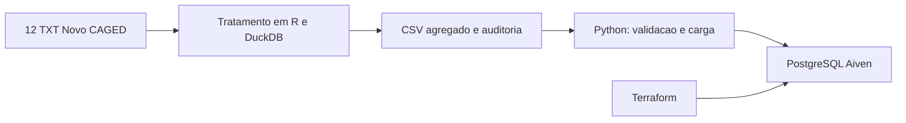

# Dinâmica de Emprego Formal e Turnover Setorial

Registro histórico da preparação da Fase 3. Consulte o [README final](README.md) para o painel e o estado da entrega.

**Equipe:** João Victor Rocha Massena, Luísa Garrido Matos e Marco Antônio Duarte Oliveira.

Preparação de microdados públicos do Novo CAGED em R, validação e carga em Python e armazenamento planejado em PostgreSQL/Aiven, com infraestrutura definida por Terraform.



O tratamento já realizado permanece em R. A partir do CSV tratado, o fluxo usa Python com DuckDB e Psycopg; R não é necessário para validar ou carregar a base publicada.

## Situação desta entrega

O tratamento e a base publicada foram validados localmente. A migração para Python inclui testes de integração com PostgreSQL temporário local. O Terraform e a documentação estão preparados. **O serviço na nuvem ainda precisa ser criado na conta da equipe e receber a carga.** Testes locais não comprovam provisionamento real. A conclusão deve ser registrada com as evidências descritas no [guia de implantação](documentacao/GUIA_IMPLANTACAO.md).

## Dados utilizados

- **Fonte:** Ministério do Trabalho e Emprego, PDET / Novo CAGED. [Página oficial dos microdados](https://www.gov.br/trabalho-e-emprego/pt-br/acesso-a-informacao/acoes-e-programas/programas-projetos-acoes-obras-e-atividades/estatisticas-trabalho/microdados-rais-e-caged).
- **Base:** arquivos mensais de movimentações `CAGEDMOV`, de `CAGEDMOV202508.txt` a `CAGEDMOV202607.txt`.
- **Recorte:** Brasil, agosto de 2025 a julho de 2026, 12 competências. Somente MOV, sem FOR, EXC ou revisões posteriores.
- **Formato de entrada:** TXT separado por ponto e vírgula, com cabeçalho e 28 colunas verificadas pelo código. O tratamento seleciona os campos necessários às categorias e medidas do projeto.
- **Rastreabilidade:** nome, competência, tamanho, contagem e hash SHA-256 dos originais estão em [arquivos_origem.csv](dados/arquivos_origem.csv). Os dicionários estão em [dicionarios.csv](referencias/dicionarios.csv).

Os TXT originais não acompanham este repositório por seu volume. A base tratada está em [base_tratada.zip](resultados/base_tratada.zip). Os registros existentes não informam a data real nem a URL de cada download original; essa informação deve ser recuperada pela equipe, sem atribuir uma data presumida. Uma nova versão dos microdados pode ter hashes e totais diferentes.

## Tratamento e justificativas

O R coordena o processo e o DuckDB lê um mês por vez, limitando memória e evitando carregar todos os TXT simultaneamente. Os SQLs em `sql/` concentram as regras de transformação.

| Característica ou problema | Decisão e justificativa |
| --- | --- |
| Espaços, vazios e cabeçalhos acentuados | Remover espaços laterais, converter vazios em nulos e padronizar nomes após conferir o cabeçalho esperado |
| Códigos categóricos numéricos | Preservar como texto e traduzir por dicionário, evitando perder a representação ou inventar rótulos |
| Competência divergente do arquivo | Interromper; quando ausente, preencher pelo mês identificado no nome do arquivo |
| Idades ausentes ou fora de 14 a 100 | Manter o evento na faixa `Nao informado ou invalido`; esse intervalo é uma decisão analítica da equipe |
| Salários com vírgula e separadores de milhar | Converter formatos decimais aceitos com até seis casas; utilizar soma decimal para preservar precisão |
| Salários negativos, inválidos ou em notação científica | Preservar o evento nas contagens; retirar o salário da média. Formatos recusados ficam na auditoria para revisão na fonte |
| Salário igual a zero | Incluir na média, mantendo a regra já adotada na etapa anterior |
| Registros aparentemente repetidos | Não remover: podem representar eventos distintos e não há identificador individual para deduplicação segura |
| Volume elevado | Agregar pelas dimensões de análise, conservando contagens e soma salarial para recompor indicadores |

A notação científica é matematicamente válida. Sua exclusão da média é uma regra explícita desta versão, motivada pela revisão dos valores extremos encontrados; não significa que todo valor nesse formato seja incorreto. A auditoria publicada contém **21 ocorrências**, derivadas dos arquivos históricos de anomalias e vinculadas ao pacote por hashes. Um novo tratamento gera sua própria auditoria mensal.

São conferidos hashes, 12 competências, unicidade de IDs e grupos, equivalência entre eventos de origem e contagens agregadas, `saldo = admissoes - desligamentos` e os limites das contagens salariais.

## Modelagem

O banco utiliza o schema `caged`, com cinco tabelas: `indicadores_emprego`, `arquivos`, `revisao_salarios`, `dicionarios` e `cargas`. A view `v_indicadores_emprego` adiciona descrições legíveis aos códigos. A [representação da modelagem](documentacao/MODELAGEM.md) detalha chaves, relações, tipos e índices; o [DDL](sql/estrutura.sql) define a estrutura física.

Uma linha de indicadores corresponde a competência, região, UF, seção CNAE, sexo, raça/cor, faixa etária, tipo de movimentação e fluxo. Essa granularidade atende análises temporais e setoriais, com menor transferência e armazenamento. Não conserva o detalhe por trabalhador, município ou ocupação na saída agregada.

A média de vários grupos deve ser calculada por `SUM(soma_salarios_validos) / NULLIF(SUM(quantidade_salarios_validos), 0)`. O recorte permite analisar admissões, desligamentos e saldo. A taxa convencional de turnover depende do estoque de vínculos e não é produzida somente a partir de MOV.

## Infraestrutura e segurança

A implementação em [infraestrutura/](infraestrutura/) declara um serviço Aiven for PostgreSQL em um projeto da conta da equipe. O plano padrão é `free-1-1gb`; a disponibilidade deve ser confirmada na conta. A região é escolhida automaticamente pelo plano gratuito. Há filtro de IPs autorizados e proteção contra exclusão. O banco padrão do serviço recebe as tabelas e a carga por Python/SQL; o Terraform provisiona o serviço, sem executar o ETL.

O armazenamento agregado reduz o volume necessário. O plano gratuito possui limites de capacidade, conexões e atividade; o tamanho efetivo do banco deve ser verificado após a carga. Não há criação automática de recursos pagos.

O token Aiven é recebido por `AIVEN_TOKEN`. O acesso PostgreSQL usa variáveis `PG*`, TLS e certificado CA com `verify-full`. Senhas, tokens, configurações privadas e estado Terraform ficam fora do Git. A [estratégia de segurança](documentacao/SEGURANCA.md) explica prompts ocultos, state fora do OneDrive, permissões e rotação de credenciais. O projeto não contém credenciais para acesso ao banco.

## Execução

Requisitos após o tratamento: Python 3.10 ou superior (ambiente testado: 3.12), DuckDB e Psycopg 3; Terraform 1.7 ou superior e inferior a 2.0; acesso à internet. R com `DBI`, `duckdb`, `digest` e `jsonlite` é necessário somente para refazer o tratamento dos TXT. A validação Python limita o DuckDB a 2 GB; o tratamento R usa limite de 4 GB.

Executar na raiz do projeto, no PowerShell. No Windows com Python instalado e disponível pelo launcher:

```powershell
py -3 -m venv .venv
.\.venv\Scripts\python.exe -m pip install -r requirements-lock.txt
```

O lock registra as versões verificadas nesta revisão. `requirements.txt` contém os intervalos compatíveis para outros ambientes. Não é necessário ativar a venv para usar seu executável.

**Validar a base publicada, sem conta na nuvem:**

```powershell
.\.venv\Scripts\python.exe codigo/executar.py validar
.\.venv\Scripts\python.exe -m unittest discover -s testes -p "test_*.py" -v
```

O primeiro comando extrai o ZIP quando necessário, valida a base e escreve `verificacoes/validacao_base_atual.json`. São conferidos hashes, contagens por mês, unicidade, relações entre medidas e auditoria. Os testes de integração são opcionais e ficam ignorados quando não há um PostgreSQL local descartável configurado.

**Refazer o tratamento:** colocar os 12 TXT em `dados_originais/` e executar:

```powershell
Rscript codigo/executar.R tratamento
.\.venv\Scripts\python.exe codigo/executar.py validar
```

**Criar a infraestrutura:** seguir o [guia](documentacao/GUIA_IMPLANTACAO.md) para criar a conta/projeto, definir o token por prompt e editar a cópia local de `terraform.tfvars.example`. Depois executar `terraform init`, `terraform validate`, `terraform plan` e `terraform apply`, com o backend privado indicado no guia.

**Carregar e conferir o PostgreSQL:** na mesma janela PowerShell, após o serviço estar disponível e com a CA baixada:

```powershell
.\codigo\configurar_conexao.ps1
.\.venv\Scripts\python.exe codigo/executar.py carga
.\.venv\Scripts\python.exe codigo/executar.py verificar-nuvem
```

A carga Python valida a base, cria tabelas e view e transmite os CSVs por `COPY FROM STDIN`, em blocos de bytes, dentro de uma transação. Isso preserva os números decimais do arquivo, sem convertê-los para `float` no transporte. Recusa tabelas preenchidas para evitar duplicação. As contagens mensais e a soma salarial são conferidas no banco antes do commit e novamente após sua confirmação. O arquivo `verificacoes/carga_nuvem.json` só é escrito após a verificação real. O modo `verificar-nuvem` apenas consulta o banco e pode ser executado novamente. Há consultas adicionais em [consultas_validacao.sql](sql/consultas_validacao.sql).

Todos os 35 arquivos da entrega anterior, incluindo os scripts R de `00` a `05`, os SQLs, os dados e o README, foram preservados integralmente. Os scripts `00`, `01`, `02` continuam disponíveis para tratar os dados. Nesta etapa, a validação e a carga usam os novos `codigo/executar.py` e `codigo/caged/`; os scripts antigos de carga em R permanecem como registro da entrega anterior. Os índices novos ficam em `sql/indices_python.sql`, sem modificar o DDL anterior. A comparação por hashes está em `verificacoes/preservacao_etapa_anterior.json`. Este arquivo separado contém as instruções da etapa atual; o README original permanece intacto.

## Resultados da base publicada

| Indicador | Valor |
| --- | ---: |
| Competências | 12 |
| Movimentações representadas | 51.893.337 |
| Linhas agregadas | 1.006.405 |
| Admissões | 26.382.492 |
| Desligamentos | 25.510.845 |
| Saldo MOV | 871.647 |

O hash da base está em [resumo_processamento.json](resultados/resumo_processamento.json). A conferência atual está em [validacao_base_atual.json](verificacoes/validacao_base_atual.json). Os demais registros de `verificacoes/` são históricos da etapa anterior e podem mencionar pendências daquela versão. Eles não comprovam carga na nuvem.

## Preparar o envio manual

Após concluir a carga real, conferir `verificar-nuvem` e atualizar o status da documentação, execute:

```powershell
.\.venv\Scripts\python.exe codigo/preparar_envio.py
```

O comando exige `carga_nuvem.json` correspondente à base validada e gera `output/envio/PROJETO_BIG_DATA_ENVIO.zip`. O pacote inclui código, documentação, evidências e a base compactada atual; exclui ambiente virtual, credenciais, state, planos e intermediários. Extraia esse ZIP em outra pasta e faça o upload manual do conteúdo de `Projeto_Big_Data` para a raiz do repositório. Nenhum comando Python deste projeto publica no GitHub. Para preparar uma cópia local antes da implantação, existe a opção explícita `--rascunho`.

## Organização e evidências

| Diretório | Conteúdo |
| --- | --- |
| `codigo/` | Tratamento em R; `executar.py` e `caged/` para validação e carga em Python |
| `sql/` | Limpeza, categorias, agregação, DDL, view e consultas |
| `infraestrutura/` | Terraform, exemplo de variáveis, lock e testes simulados |
| `documentacao/` | Modelagem, segurança, implantação e atendimento aos requisitos |
| `dados/` | Metadados dos originais, auditoria salarial e manifesto do pacote |
| `referencias/` | Dicionários de códigos |
| `resultados/` | Base tratada compactada e resumo do processamento |
| `verificacoes/` | Evidências locais, históricas e futura validação da nuvem; `carga_python_teste_local.json` é somente um teste local |
| `testes/` | Regras do tratamento em R; testes Python de integridade, TLS, COPY e rollback |

Consulte o [mapa dos entregáveis](documentacao/ENTREGA.md) e o [registro de testes](documentacao/VALIDACAO.md). Esta revisão está preparada localmente para publicação manual pela equipe. A entrega completa depende de provisionamento real, carga conferida e atualização do repositório pela equipe.

Referências técnicas: [Terraform/Aiven](https://registry.terraform.io/providers/aiven/aiven/latest/docs/resources/pg), [plano gratuito](https://aiven.io/docs/products/postgresql/concepts/pg-free-tier), [DuckDB para R](https://duckdb.org/docs/stable/clients/r), [DuckDB para Python](https://duckdb.org/docs/stable/clients/python/overview), [COPY no Psycopg](https://www.psycopg.org/psycopg3/docs/basic/copy.html).
