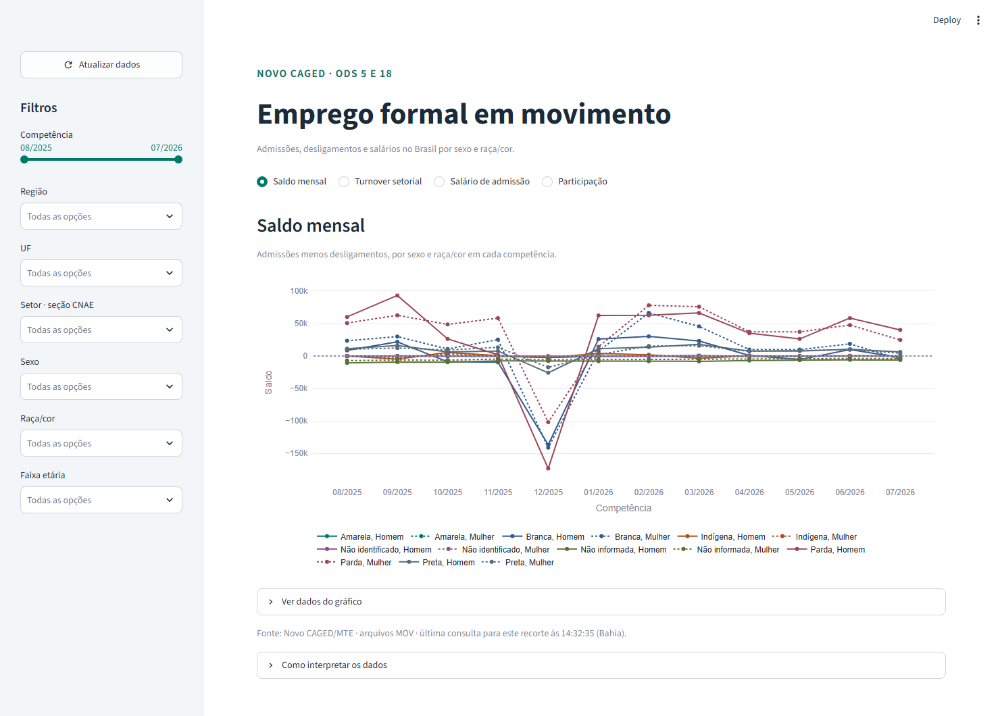
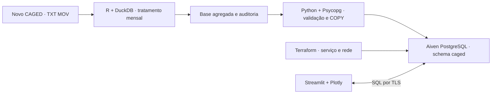
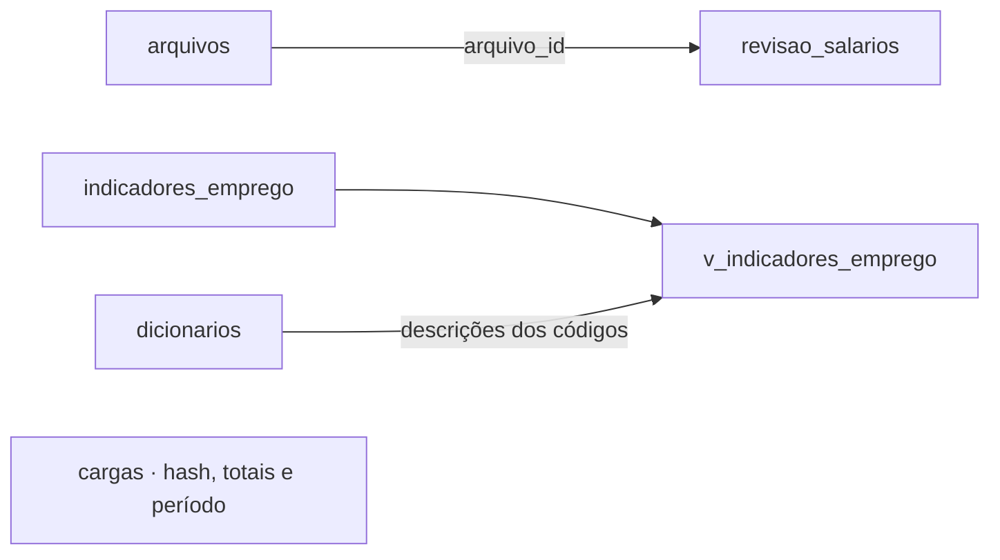

# Dinâmica de Emprego Formal e Turnover Setorial

Projeto de Big Data e Analytics da UCSal. **Equipe:** João Victor Rocha Massena, Luísa Garrido Matos e Marco Antônio Duarte Oliveira.

O painel investiga quem entra e sai do emprego formal e como o salário de admissão varia no cruzamento entre sexo e raça/cor. A análise atende à ODS 5, de igualdade de gênero, e à ODS 18 brasileira, de igualdade étnico-racial.

## Abrir o painel

Com Python 3.12, as dependências de `requirements.txt` e a conta de leitura configurada, execute na raiz:

```sh
python -m streamlit run dashboard/app.py --server.address localhost
```

O painel consulta diretamente o PostgreSQL do projeto. Alterar os filtros gera consultas parametrizadas. **Atualizar dados** invalida o cache e consulta novamente. Para preparar a conta, configurar `.env` e publicar no Streamlit Community Cloud, consulte o [guia do painel](documentacao/DASHBOARD.md).



[Turnover setorial](documentacao/capturas/turnover.png) · [Salário de admissão](documentacao/capturas/salario.png) · [Participação por setor](documentacao/capturas/participacao.png)

## Indicadores

| Indicador | Definição e interação |
| --- | --- |
| **Saldo mensal** | Admissões menos desligamentos por competência, sexo e raça/cor. O gráfico mostra a evolução mensal e a tabela permite conferir as contagens de cada grupo. |
| **Turnover setorial** | Desligamentos divididos por admissões, por seção CNAE, mês, sexo e raça/cor. O gráfico inclui seleção de setor e competência. Sem admissões, a razão fica indefinida. |
| **Salário de admissão** | Soma dos salários válidos dividida pela quantidade de salários válidos, somente em admissões, por sexo e raça/cor. A tabela mostra o percentual da maior média do recorte e a quantidade de salários usada. |
| **Participação por setor** | Percentual de mulheres e de pessoas negras em cada fluxo. Pessoas negras correspondem às categorias preta e parda. A série de mulheres responde ao filtro de raça/cor. A série de pessoas negras responde ao filtro de sexo. |

Filtros de competência, região, UF, seção CNAE, sexo, raça/cor e faixa etária. **Não informada** e **Não identificado** aparecem como categorias separadas. A documentação detalha pesos, denominadores e regras para ausência de dados. [Metodologia](documentacao/INDICADORES.md)

## Resultados e limites

A base representa **51.893.337 movimentações** entre agosto de 2025 e julho de 2026 em **1.006.405 linhas agregadas**. Foram **26.382.492 admissões**, **25.510.845 desligamentos** e saldo MOV de **871.647**. A conferência de 21/11/2026 registrou **195.507.903 bytes** no Aiven e confirmou TLS, totais mensais e somas salariais. As consultas abaixo foram executadas com a conta de leitura do painel. [Evidência da carga atual](verificacoes/carga_nuvem.json) · [Consultas de reprodução](sql/analise_ods.sql)

- **ODS 5.** Mulheres responderam por **43,21%** das admissões e **42,48%** dos desligamentos. Entre as admissões, a participação feminina foi de **8,58%** na Construção e **78,24%** em Saúde Humana e Serviços Sociais. A diferença mostra como a composição das contratações varia com o setor.
- **ODS 18.** Pessoas pretas e pardas somaram **59,99%** das admissões e **58,22%** dos desligamentos. Mulheres pretas e pardas corresponderam a **24,25%** das admissões e **23,02%** dos desligamentos. A composição dos fluxos por grupo complementa a leitura do saldo.
- **Gênero e raça/cor juntos.** O salário médio de entrada foi de **R$ 2.202,79** para mulheres pretas e **R$ 2.160,15** para mulheres pardas, ante **R$ 2.909,42** para homens brancos. A média de homens com raça/cor não informada foi de **R$ 8.589,40**, com apenas **97 admissões** no grupo. O tamanho de cada grupo importa ao interpretar o percentual da maior média.

O recorte cobre movimentações do emprego formal. Análises de participação descrevem eventos, que podem se repetir para a mesma pessoa. O saldo MOV exclui FOR, EXC e revisões posteriores. Sem estoque dos vínculos, o painel usa uma razão de fluxos para o turnover. A base registra **157.561** movimentos com raça/cor não informada e **4.948** não identificados. A comparação salarial é descritiva, em valores nominais e sem controles de ocupação, escolaridade ou jornada.

## Arquitetura e modelagem





A linha da tabela de fatos combina competência, região, UF, seção CNAE, sexo, raça/cor, faixa etária, tipo de movimentação e fluxo. Contagens usam `BIGINT` e a soma salarial usa `NUMERIC(38,6)`. PostgreSQL permite transações de carga, integridade e agregações SQL sobre o modelo relacional. [Diagrama ER, chaves e dicionário](documentacao/MODELAGEM.md) · [Códigos das categorias](referencias/dicionarios.csv)

O Aiven Free existente foi reconciliado com o state privado do Terraform. O ajuste incluiu um IPv6 `/128` para acesso ao PG Studio. O plano posterior confirmou convergência. [Evidência da infraestrutura](verificacoes/terraform_entrega.json)

## Dados, qualidade e 5 Vs

| V | Aplicação |
| --- | --- |
| Volume | Agregação mensal antes do envio ao plano gratuito, com contagens e somas preservadas. |
| Variedade | TXT delimitado e tabelas são estruturados. Manifestos JSON são semiestruturados. A base analítica dispensa fontes textuais não estruturadas. |
| Velocidade | Tratamento em lote por competência e consultas interativas ao PostgreSQL com cache curto. |
| Veracidade | Conferência de cabeçalhos, competências, SHA-256, contagens e somas. Idades inválidas permanecem em uma categoria própria e salários recusados saem da média. |
| Valor | Recortes interseccionais tornam visíveis diferenças de participação e remuneração de entrada entre grupos e setores. |

A base usa microdados públicos do MTE. A entrega publica agregados e metadados, com um recorte sem identificadores individuais e aderente à finalidade acadêmica. O pipeline preserva eventos semelhantes, pois os dados carecem de identificador para deduplicação segura. [Fonte oficial Novo CAGED/PDET](https://www.gov.br/trabalho-e-emprego/pt-br/acesso-a-informacao/acoes-e-programas/programas-projetos-acoes-obras-e-atividades/estatisticas-trabalho/microdados-rais-e-caged) · [Proveniência e hashes](dados/arquivos_origem.csv)

## Evolução do projeto

| Etapa | Planejamento ou entrega | Evolução e motivo |
| --- | --- | --- |
| Fase 1 | R para leitura, Python/Pandas para chunking e PostgreSQL/Aiven para agregados. | O DuckDB assumiu o processamento em SQL por competência, coordenado pelo R. |
| Fase 2 | Tratamento de 17 campos, agregação mensal e carga RPostgres em blocos. | A camada analítica preservou dimensões, contagens e pesos salariais. Campos detalhados ficaram na preparação e os originais foram rastreados por hash. |
| Fase 3 | Validação e carga em Python com infraestrutura versionada. | Psycopg passou a enviar o CSV por `COPY` transacional. O serviço Free existente no Aiven foi importado para o Terraform. |
| Entrega final | Painel interseccional e demonstração. | Aiven permaneceu como provedor. Streamlit e Plotly consultam a view PostgreSQL por TLS, com filtros, detalhamento e quatro indicadores. |

## Reprodução, testes e segurança

- **Tratamento e carga.** R com DBI, DuckDB, digest e jsonlite. Python com DuckDB e Psycopg valida e carrega a base. Terraform gerencia o serviço no Aiven. [Implantação e carga](documentacao/GUIA_IMPLANTACAO.md)
- **Testes.** Execute `python -m unittest discover -s testes -p "test_*.py" -v`. Para os testes de leitura, configure `PG*` e `CAGED_TESTE_DASHBOARD=1` e repita o comando. [Evidências e instruções](documentacao/VALIDACAO.md)
- **Segurança.** O painel usa TLS `verify-full` e uma conta de leitura da view. `.env`, token, CA local, variáveis privadas, state e planos Terraform ficam fora do Git. Rode `python codigo/verificar_segredos.py` para verificar o índice antes do envio. [Gestão de acessos](documentacao/SEGURANCA.md)
- **Apresentação.** [Roteiro de 10 minutos](documentacao/PITCH.md)
