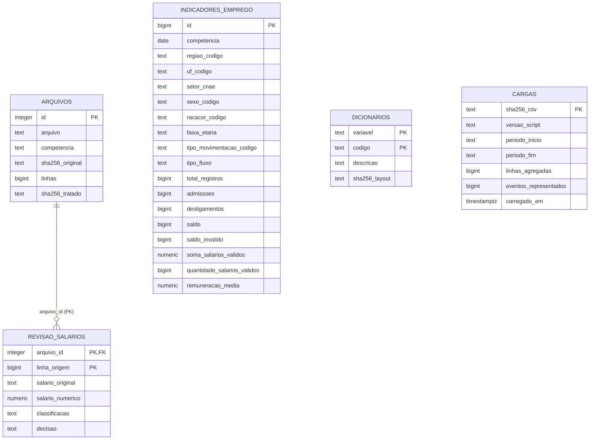

# Modelagem da camada de dados

A solução usa PostgreSQL relacional com uma tabela de fatos previamente agregada. A unidade da tabela `caged.indicadores_emprego` é a combinação de competência mensal, região, UF, seção CNAE, sexo, raça/cor, faixa etária, tipo de movimentação e tipo de fluxo. Cada linha representa um grupo de eventos, e `total_registros` informa quantos eventos foram representados.

Essa escolha reduz o volume transferido para a nuvem e permite análises por período, localidade e setor usando SQL. Há perda deliberada da granularidade individual e de campos como município, ocupação e escolaridade na saída agregada. Os arquivos originais devem ser preservados para novos recortes.

O diagrama apresenta as tabelas físicas e a única relação imposta por chave estrangeira. `dicionarios` é uma tabela de referência com chave composta `(variavel, codigo)`; a view `caged.v_indicadores_emprego` faz seis junções lógicas para traduzir os códigos. Não há seis chaves estrangeiras físicas para esse dicionário. `cargas` registra a origem de cada carga pelo hash do CSV, sem relacionamento de linha com a tabela de fatos. A implementação atual aceita somente uma carga inicial no schema.

| Tabela/view | Finalidade |
| --- | --- |
| `arquivos` | Identificação, tamanho, quantidade de registros e hashes dos 12 TXT e seus agregados |
| `indicadores_emprego` | Fatos e medidas por grupo; chave primária `id` |
| `revisao_salarios` | Ocorrências salariais excluídas da média, mantendo o evento nas contagens |
| `dicionarios` | Descrições dos códigos e hash do layout de referência |
| `cargas` | Controle da carga por hash, versão, período e totais |
| `v_indicadores_emprego` | Camada de consulta com descrições legíveis |

Contagens e IDs usam `BIGINT`; datas usam `DATE`; códigos são `TEXT` para preservar a representação; a soma salarial usa `NUMERIC(38,6)`. A média armazenada é derivada. Para recompor a média de vários grupos, utilizar `SUM(soma_salarios_validos) / NULLIF(SUM(quantidade_salarios_validos), 0)`, sem fazer média simples das médias.

Os índices em `competencia` e `(uf_codigo, competencia)` atendem filtros temporais e geográficos. A chave primária também cria índice em `id`. As validações em R conferem unicidade dos grupos, totais e consistência dos indicadores; a chave primária e a FK da auditoria são impostas também pelo PostgreSQL. O DDL completo está em [estrutura.sql](../sql/estrutura.sql).

O projeto permite estudar admissões, desligamentos e saldo. A taxa convencional de turnover precisa do estoque de vínculos como denominador; essa medida não é calculada somente com os arquivos MOV.
